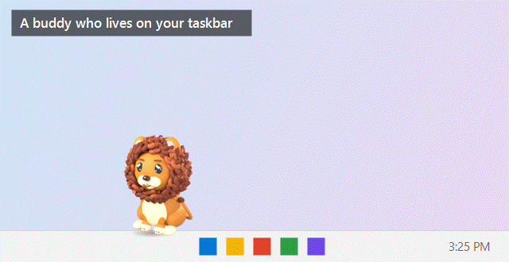

<p align="center">
  
</p>

<h1 align="center">Assistail</h1>
<p align="center"><b>An assistant with a tail.</b><br>
A bright-eyed, bushy-tailed coding partner that lives on your Windows taskbar and chats with you through <a href="https://claude.com/claude-code">Claude Code</a>.</p>

<p align="center">
  <a href="https://github.com/NaveedMohammed/assistail/releases/latest"></a>
  <a href="https://github.com/NaveedMohammed/assistail/releases"></a>
  <a href="LICENSE"></a>
  
</p>

<p align="center"></p>

> **Unofficial project.** Assistail is a free, community-made companion for Claude Code. It is not affiliated with,
> endorsed by, or sponsored by Anthropic. "Claude" and "Claude Code" are trademarks of Anthropic, PBC.

## What it does

- 🦁 **A 3D cartoon buddy on your taskbar**: a curly-maned lion who breathes, blinks, naps and reacts. You name him on first launch.
- 💬 **Click to chat**: a chat box opens beside him and answers stream in from Claude, through your own Claude Code login (no API key).
- 🎩 **Tricks and quirks**: head shake, jump, stretch & yawn, tail chase, wave, roar, strolls, chasing your pointer, and playing with a butterfly 🦋. Pick them from the right-click menu, cycle them with a hotkey, or let him do them on his own when idle.
- 🗨️ **Speech bubble**: make him say anything, or let him chat a little on his own.
- 📂 **"Open Claude Code here"**: in the Explorer right-click menu, the buddy's menu and the chat window.
- 🧭 **Ask him to open folders**: type `open claude in my-app`, `open claude in the folder in D drive named reports` or `switch to downloads`. He finds the folder (with clickable choices if there are several) and opens Claude Code there.
- ⌨️ **Shortcuts**: `Ctrl+Alt+Space` to chat, `Ctrl+Alt+T` for the next trick. Both can be changed in the app.
- 🔋 **Light on battery**: about 1% of one CPU core when active, less when idle, and zero while the PC is locked or the screen is off.

More animals are planned. The app is built to host different buddies.

## Install

1. Download the latest **`Assistail-x.y.z.zip`** from the [Releases](../../releases) page and unzip it.
2. Double-click **`Install.cmd`**. No admin rights needed.
   The app isn't code-signed, so Windows may show *"Windows protected your PC"*: click **More info → Run anyway**.
3. Your buddy appears on the taskbar and asks for a name.

**Requirements:** Windows 10/11 (64-bit) and the [Claude Code](https://claude.com/claude-code) CLI, installed and signed in
(run `claude` once in a terminal). .NET is bundled.

The full user guide (`Assistail Guide.html`) is included in the zip and opens from the buddy's right-click menu.

## Using it

| To… | Do this |
|---|---|
| Chat | Click the buddy, or press `Ctrl+Alt+Space` |
| Options | Right-click the buddy (or the tray icon) |
| Move him | Drag him along the taskbar |
| A trick | Right-click → Tricks, or press `Ctrl+Alt+T` (each press = next trick) |
| Make him talk | Right-click → Make … say something… |
| Send away / call back | Right-click, or type `go away` / `come back` in the chat |
| Claude Code in a folder | Right-click inside a folder in Explorer → *Open Claude Code here*, or type `open claude in <folder name or path>` in the chat |

## Privacy

Chat messages go through your local Claude Code CLI to Anthropic, using your own account, exactly as if you typed them
into Claude Code. Assistail has no servers and collects nothing. Settings and a small log stay on your PC in
`%LOCALAPPDATA%\Assistail`. Uninstalling removes everything it added.

## Building from source

Requires the .NET 8 SDK on Windows.

```powershell
dotnet build app -c Release          # dev build: app\bin\Release\net8.0-windows\Assistail.exe
.\build-package.ps1                  # release zip -> release\Assistail-<version>.zip (self-contained)
```

### The art

The buddy is built procedurally in [Blender](https://www.blender.org/) 4.5 with Python scripts, so no third-party models are used.
Rendered frames are committed in `assets/lion`, so you only need Blender to change the art.

```powershell
$B = "<path to>\blender.exe"
& $B -b --factory-startup -P tools/procedural_lion.py -- '{"out": "C:/temp/lion.png", "curl_style": "poofy"}'   # a still
& $B -b --factory-startup -P tools/animate_lion.py -- '{"state": "idle", "outdir": "design/anim"}'               # one animation
.\tools\build_lion_assets.ps1                                                                                  # copy frames into assets/lion
```

`design/chosen.json` holds the approved look (fur, mane, head and ear sizes). Animation states: idle, hover, thinking,
talking, happy, dragged, landing, sleep, turn, stand_up, walk, shake_head, jump, stretch_yawn, tail_chase, wave,
look_roar, look_up, swat, plus `tools/butterfly.py`.

### Project layout

| Path | What's there |
|---|---|
| `app/App.xaml.cs` | Startup, hotkeys, wiring |
| `app/LionWindow.cs` | The buddy: animation state machine, tricks, quirks, drag, leave/return, power saving |
| `app/LayeredSurface.cs` | Native per-pixel-alpha window used for the buddy and the butterfly |
| `app/ChatWindow.xaml(.cs)` / `ClaudeCli.cs` | Chat UI and the `claude -p --output-format stream-json` bridge |
| `app/TrayIcon.cs`, `ShortcutsDialog`, `NameDialog`, `SpeechBubble` | Menu, settings dialogs, speech bubble |
| `installer/` | Install/uninstall scripts and the user guide |
| `tools/` | Blender art pipeline, icon scripts |

Testing aids: set `ASSISTAIL_TRICK=butterfly` (or `say:Hello`, or a comma list) to run tricks at startup, and
`ASSISTAIL_PROFILE=1` to log render timings.

## License

[MIT](LICENSE)
